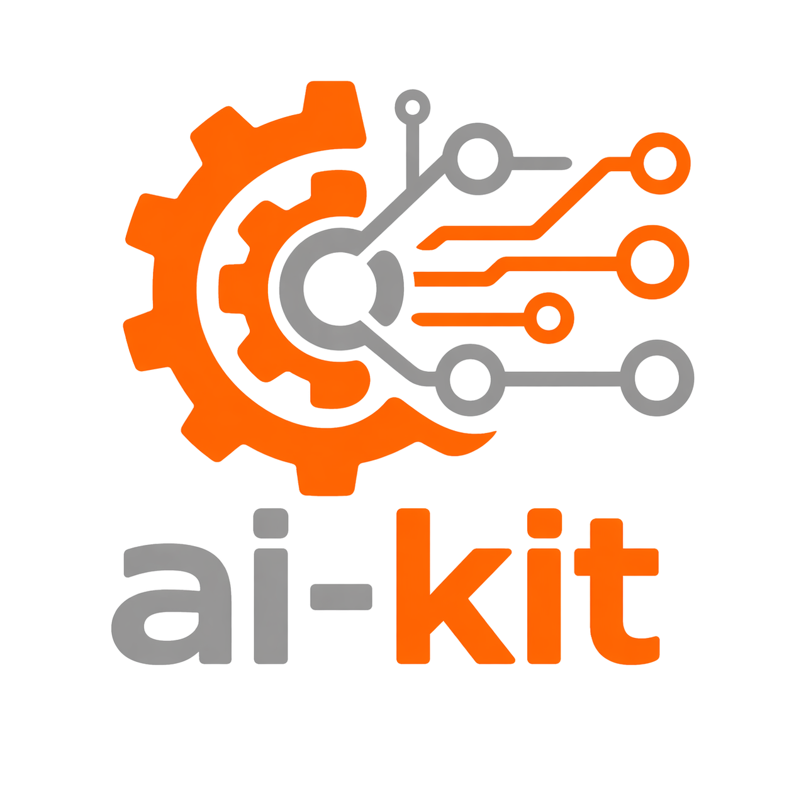

# ai-kit

<p align="center">
  
</p>

`ai-kit` is a private Rust workspace of reusable Genaptic SDK building blocks.
It contains five independently usable library crates:

| Crate | Primary hierarchy | Purpose |
| --- | --- | --- |
| `provider-sdk` | `Provider -> Model -> Session` | Portable model and provider resources across OpenAI, Anthropic, Gemini, and Ollama |
| `storage-sdk` | `Database`; `StateStore -> StateTransaction` | Portable data/search plus transactional control-plane storage |
| `tool-sdk` | `Toolset -> ToolHandler` | Executable Local/MCP tools and independent MCP serving |
| `agent-sdk` | `Agent -> Workspace -> Conversation` | Portable Codex, OpenCode, and provider-backed Custom agents |
| `app-sdk` | `App -> Workspace -> Workflow -> WorkflowRun` | Durable application and workflow orchestration over caller-built agents |

## Public Design

Each supplied lower-crate handle is an opaque public value over private
exhaustive enum dispatch. Built-ins remain concrete private variants.
Provider, Storage, and Agent public RPITIT traits support direct static
implementations without routing them through a supplied handle.

The eleven lower-crate implementation traits are:

- `ProviderBackend`, `ModelBackend`, `SessionBackend`;
- `DatabaseBackend`, `StateStoreBackend`, `StateTransactionBackend`;
- `ToolsetBackend`, `ToolHandlerBackend`;
- `AgentBackend`, `WorkspaceBackend`, `ConversationBackend`.

App adds five concrete workflow behavior contracts under `workflow`:
`ActionBackend`, `ConditionBackend`, `StateTyping`, `LifecycleHooks`, and
`ChildExecutor`. The last uses an associated future for local non-Send child
execution; other async contracts use RPITIT. Exact signatures belong to the
owning specifications.

Parent traits declare their child implementation with an associated type.
There is only one public erased extension constructor:

```text
Toolset::from_backend
```

ToolHandlers are returned by their Toolset and normalized privately. Provider,
Storage, and Agent callers use direct static trait implementations and
associated child types; their supplied handles contain built-ins only.

The workspace intentionally has no public conformance framework, durable
lower-crate factory API, `LoopDriver`, hosted-tools dispatcher, public
KnowledgeBase backend, storage-to-tool adapter, portable database realtime,
general-purpose runtime registry, compatibility layer, or serialized trait
object. App's narrow serialization-only field/tag codec registry does not
erase workflow behavior or lower backends.

## Public Modules

Primary handles, backend traits, and errors remain at crate roots. Supporting
types are organized into functional modules:

```text
provider_sdk::{
    config, generation, embedding, hosted, files, batch, models, session,
    runtime, error
}

storage_sdk::{
    database::{config, catalog, data, query, index},
    state::{config, record, transaction}
}

tool_sdk::{declaration, execution, interaction, local, mcp, schema}

agent_sdk::{
    config, identity, workspace, conversation, prompt, notification, model,
    tool, knowledge, error
}

app_sdk::{workflow}
```

This keeps the root surface small without exposing implementation trees.

## Provider Workflow

Construct a Provider from validated provider configuration, choose an exact
provider-local `ModelId`, then perform generation, streaming, embeddings,
batch submission, or session creation on the resulting Model.

Portable function use is represented by validated `FunctionCall` and
`FunctionResult` values. `ModelBackend::Continuation` associates replay state
with the selected Model; the supplied `GenerationContinuation` keeps its native
contents opaque. Callers retain the returned assistant message unchanged
before adding a function-result message. Native provider envelopes never cross
the public boundary.

Portable hosted tools use the closed `HostedTool` enum inside
`ProviderToolSpec`. The selected Model validates whether it supports the
requested tool and returns an honest unsupported error when it cannot.

## Tool Workflow

Construct executable tools directly:

```text
Toolset::local(Vec<ToolRegistration>)
Toolset::mcp(McpClientConfig)
```

List `ToolInfo` values, request an associated handler by `ToolName`, and drive
that unique handler through its input/output state machine. Accepted
model-visible failures are completed `ToolResult` values marked as errors;
outer errors represent transport, protocol, cancellation, state, or lifecycle
failure.

MCP serving is a separate `McpServer` product. It serves any Toolset, owns and
joins its server task, and never shuts down the underlying shared Toolset.

## Storage Workflow

`Database::connect(DatabaseConfig)` selects always-available LanceDB, opt-in SurrealDB, or
feature-gated Qdrant. Its portable API contains only operations with honest
matching semantics in at least two backend families.

`StateStore::connect(StateStoreConfig)` selects always-available embedded Lance or opt-in
Redb, PostgreSQL, or SQLite/Turso. `begin_transaction` returns an owned
StateTransaction with read, write, delete, consuming commit, and consuming
rollback behavior.

StateStore actors preserve bounded admission, exact revision conflicts,
rollback-on-drop, cancellation safety, and deterministic task/thread cleanup.
Database and StateStore are independent products. Callers implement
`DatabaseBackend` or `StateStoreBackend` directly, with the latter returning
its own `StateTransactionBackend` associated type. A caller-owned enum may
provide optional runtime composition without an SDK `Extension` variant.

## Agent Workflow

Agent construction requires `AgentConfig` plus `AgentStorage<S>`, where `S`
is a direct `StateStoreBackend`. Custom agents receive a direct
`P: ProviderBackend` implementation and already-built `T: ToolsetBackend`
values, and may receive a `D: DatabaseBackend` for private managed knowledge. Native Codex and
OpenCode builders may select the same static `P` type without constructing or
owning a provider value, so native and Custom Agents can share one
caller-owned provider enum in an App inventory. Built-in defaults preserve the
ordinary `AgentStorage`, `Agent`, `Workspace`, and `Conversation` spellings.
The Agent hierarchy retains `S`, `D`, `P`, and `T`; handlers remain exact
`T::Handler` values. Neither toolsets nor their handlers need Clone.
Reopening requires callers to resupply runtime values; agent-sdk does not
persist lower-crate credentials or reconstruction declarations.

The direct static traits form `Agent -> Workspace -> Conversation`. Caller
implementations return their own associated child types or use matching
caller-owned enums. Supplied handles remain closed over Codex, OpenCode, and
Custom.

Custom owns the multi-turn prompt loop. It selects a Model, preserves
provider continuation messages, executes ToolHandlers, publishes durable
interaction notifications, applies agent-owned limits and approvals, and
settles cancellation and cleanup within existing lifecycle deadlines.

Codex and OpenCode protocol models remain private to their backend subtrees.
All backends share the same public notification, conflict, close, shutdown,
and durable-reopen contracts.

## Application Workflow

Callers supply an app control-plane `CS: StateStoreBackend` and transfer ready
`A: AgentBackend` values through `AgentSpec<A>` into `AppConfig<CS, A>`.
Callers choose `CS` and `A` explicitly; App does not require supplied lower
handles or provide lower-type defaults. App-sdk validates
workflows, coordinates app workspaces, and persists only app-owned workflow
state. It never reconstructs agents or inspects `AgentId`, lower credentials,
protocols, or storage records.

## Contributing

The [operating contract](AGENTS.md) contains mandatory Rust, dependency,
public-boundary, lifecycle, and testing rules, including their narrowly
approved exceptions. Read it together with the owning crate's `AGENTS.md`
before changing that crate. [Architecture](ARCHITECTURE.md) explains the
ownership model; focused crate specifications define exact contracts.

## Start Here

- [Workspace architecture](ARCHITECTURE.md)
- [Repository operating contract](AGENTS.md)
- [Workspace skill catalog](SKILLS.md)
- [agent-sdk](agent-sdk/README.md)
- [provider-sdk](provider-sdk/README.md)
- [storage-sdk](storage-sdk/README.md)
- [tool-sdk](tool-sdk/README.md)
- [app-sdk](app-sdk/README.md)

Each crate's `AGENTS.md` owns its exact validation commands. The shared final
gate covers formatting, clippy across supported feature lanes, docs/doctests,
source/compile contracts, no-path/no-alias checks, all five strict-live
verifiers, and a locked clean-checkout proof.

For an explicit continuation using verified unchanged receipts, follow the
[release qualification guide](docs/release-qualification.md). Reused and newly
executed checks remain distinct, and every required gate remains represented.
An explicitly requested `--skip-strict-live` pass runs the local gates and lists
all five live suites as deferred; it does not qualify a full workspace release.

The workspace completion wrapper (`bash scripts/verify_workspace_strict.sh`)
requires full provider coverage by default. In full mode it validates the effective
provider environment before any gate starts and rejects long-batch mode `0` unless
`--skip-long-provider-batches` is explicitly supplied. That flag runs all five
crate verifiers and every other workspace check, using the Provider verifier's
existing partial mode to exclude only its four long OpenAI batch completion
cases and the Anthropic inline, mixed-row and bounded-results completion cases.
Anthropic cancellation, missing-resource and unsupported-input cases remain
required. Success is reported as **QUALIFIED**, with all seven exclusions named;
it does not establish full Provider coverage. Any remaining test or gate failure
fails workspace completion. The flag overrides only the Provider child after
its environment is sourced; malformed toggle values remain errors.
The Storage verifier runs the selected deterministic lanes before starting
services; its default is Lance-only, and `--all-backends` adds all eight lanes
and the complete legal/illegal feature matrix. Any owned service-cleanup
failure also fails the gate.
Agent's [strict-testing contract](agent-sdk/docs/STRICT_TESTING.md) and Provider's
[strict-testing contract](provider-sdk/docs/STRICT_TESTING.md) separate raw
model-copy quality for exactly two OpenCode Question cases and two OpenAI
Realtime cases. SDK correctness, correlation, output progress, authoritative
terminals, complete grade receipts and cleanup remain mandatory. OpenCode also
requires independently observed native/portable terminal-text fidelity and
unchanged native Question descriptions; answer and description copying are
reported as separate quality grades. Realtime requires new audio and nonblank transcription after successful
function-result submission, without claiming native parity or semantic use of
the result. Report every exact-copy grade, including nonblocking failures;
these observations establish neither model-quality acceptance nor reliability.
All other acceptance rules, including knowledge and recovery, remain unchanged.
The locked clean-checkout proof is additionally required and recorded
separately; the wrapper itself does not perform that snapshot validation.

## Primary deterministic CI

Run `bash scripts/check_ci.sh` for direct public-trait mocks and real Custom
Agent/App composition tests. [Mock testing](docs/mock-testing.md) documents the
separate target selection, coverage, receipts, and network-restricted runtime
qualification. Native integration and strict-live release gates remain separate
and required.

Known defects and unresolved coverage belong in the
[mock-testing bug ledger](docs/mock-testing-production-bugs.md). Dated results
live in [PR #22 validation history](docs/pr22-validation.md); they do not certify
the current checkout.
